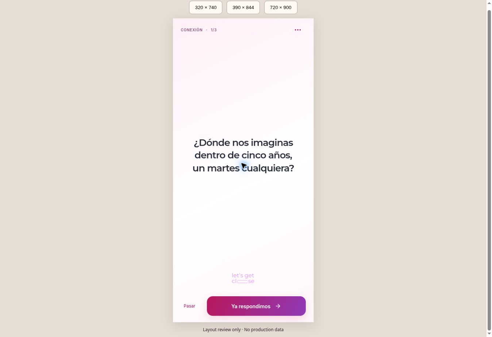
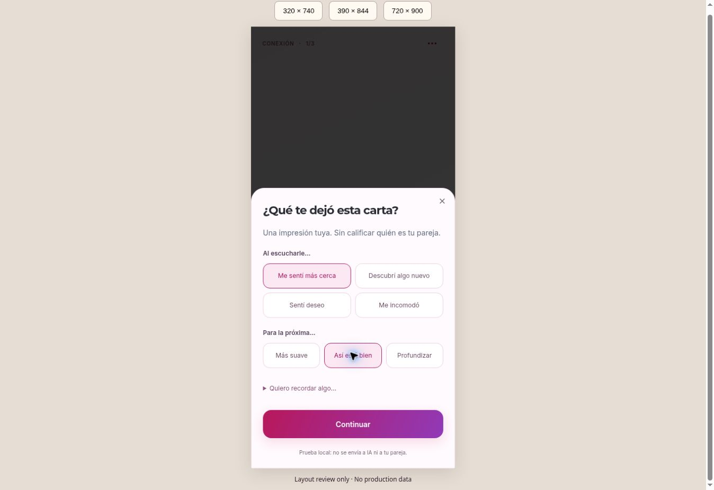
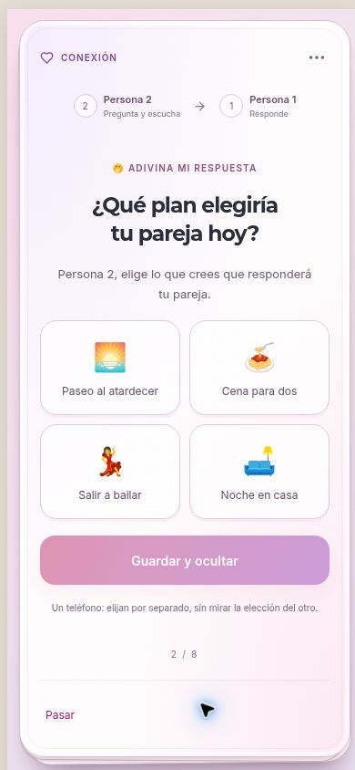
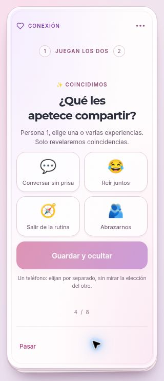
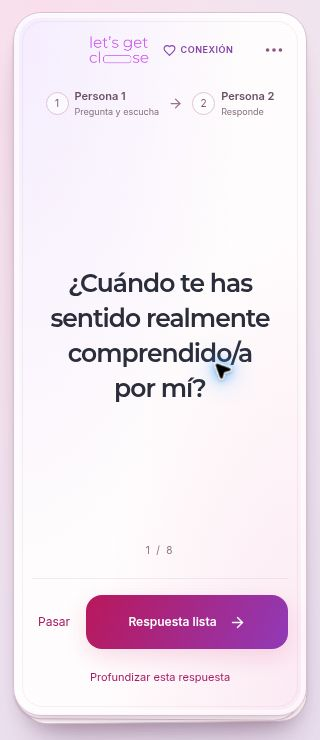
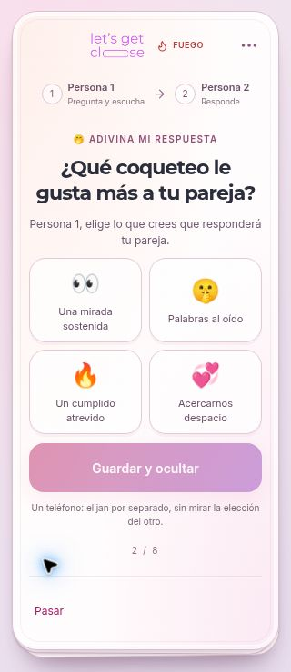

# Let’s Get Close — launch candidate

This branch builds on `claude/project-complete-analysis-30nhin` at `2d3b74f`, preserving its realtime rooms, account upgrade, Premium, four languages and existing question library. That branch was 23 commits ahead of `main` when reviewed. Do not replace it with an older checkout.

## Product change

The optional `/together` route provides a complete, free, single-phone evening with no account, checkout, answer recording or per-answer ratings. Couples choose a mood, approximate duration (6/10/16 cards), independent sensuality and emotional-depth limits, then each confirms the pace and adulthood. Changing preferences clears both confirmations. Cards turn over on tap; partners speak, guess each other's answers, pass, pause, soften the remaining deck or end early. Optional favorite **card IDs** are retained only with this tab's session, not partner answers. A refreshed page resumes for up to eight hours. The closing card invites an actual next date.

Sixty existing editorial questions, in English, Spanish, Portuguese and French, now share one catalog between the Daily Spark, landing previews, local play and AI planner. No database question content was replaced. The paper card component is also used by existing realtime rooms. Reduced motion disables the flip transition.

Optional AI prepares an order of existing question IDs within explicit limits. It does not listen, interpret unrecorded speech, generate intimate profiles, or adjust consent. A failed/slow request falls back to the editorial deck within eight seconds; a late response cannot replace an active game. Server limits: five attempts per identity per day and 500 total per day. This limits spend but is not full abuse prevention against disposable guest identities; configure Supabase anonymous sign-in protections before exposing the online service.

## Privacy and payment changes

- Both online players now require real Supabase identities (permanent or anonymous-auth JWT). Forged `localStorage` player UUIDs are removed.
- A new migration removes no-JWT reads/writes on room data, binds join and game RPCs to `auth.uid()`, serializes seat assignment, and revokes historical SECURITY DEFINER maintenance RPCs from clients. The client allowlist uses **exact signatures**, so older overloads cannot inherit access accidentally.
- Edge room guards reject missing identities before querying data. Recent rooms are no longer a public access window.
- `grant_checkout_credits` atomically commits the Stripe ledger and credits. Webhook and success-page verification use the same transaction. Subscription checkout no longer claims a ledger record before persisting state.
- Removed an unsupported comparative percentile from new analysis generation and from rendering old reports. Existing compatibility/bond metrics still describe user ratings; they are not validated clinical or relationship diagnostics. A deeper report redesign remains separate.
- Pageview URLs omit invite query strings. CORS supports the original `.com` domain and retains `.app` compatibility. Canonical URLs, sitemap and robots now use the owner-confirmed `.com`; support mailbox ownership is still unverified.

## Validation

`npm run typecheck`, `npm test`, `npm run build` and lint of the new surfaces are the release checks. Node 24 is required by the test runner. Tests execute the actual new SQL migrations in embedded PostgreSQL with a minimal schema fixture; they cover cross-room isolation, forged identities, legacy RPC privileges, seat limits, duplicate grants, transactional rollback/retry and AI usage caps. They also exercise all 54 deck configurations repeatedly, model-output validation, four-language completeness, and session recovery/expiry.

These are not a substitute for applying all historical migrations and testing two real clients against Supabase Realtime. Full-repository ESLint had 171 errors and 38 warnings **before** this change. CI gates type checking, focused lint, SQL/domain tests and production build without claiming that legacy lint debt is fixed.

## Deployment status and order

The configured Supabase ref is `bbdeyohqrutithaziulp`. It was absent from both connected Supabase accounts. The original Lovable project `9efb8ab7-d861-473b-88f1-2736da9c245d` returned `project_not_found` from the connected account. No production database, Edge Function, Stripe configuration, DNS, original published site or `main` branch was changed during development.

1. Restore access to the existing Supabase and hosting projects. Inspect deployed migrations and function versions first; this repository contains historical migrations and the August launch migrations were not previously verified as applied.
2. In staging, enable anonymous sign-in and verify the profile trigger from the August migration. Apply pending migrations in order, including `20261026110000_private_guest_rooms.sql` and `20261026120000_atomic_credits_and_date_plans.sql`. Do not bulk-run an unreviewed historical migration backlog against production.
3. Redeploy `intelligent-question-selector`, `getclose-ai-analysis`, `send-ai-analysis-email` (shared membership guard), `stripe-webhook`, `verify-payment`, and the new `plan-date` function. Supply the existing OpenAI/Stripe secrets and an explicit `ALLOWED_ORIGINS` list. No new secret is embedded in browser code.
4. Deploy the frontend together with the membership changes. Legacy no-JWT guests must rejoin using a new verified guest identity; schedule the cutover outside active games. Preserve prior branches for rollback, but do **not** roll back the privacy fix to public room access.
5. Verify two actual clients: create/pay or Premium entitlement, invite join, reconnect, level choice, one complete game and analysis access. Check a third identity cannot read either room. Replay a test-mode Stripe checkout through webhook and verification; ensure a single credit grant. Verify AI outage fallback and allowed-origin requests.
6. Only then promote the candidate to production and verify the canonical domain.

`VITE_TABLE_PREVIEW=true` now builds an isolated, explicitly labeled visual review of the connect → levels → cards flow at every route. It does not create rooms, simulate actual partners, process payments or request AI. It is explicitly labeled as a preview and must be unset for the full release. `vercel.json` supplies SPA deep-link rewrites; no domain is reassigned by that file.

## Previous one-phone browser review (superseded visual direction)

Playable isolated preview: https://lets-get-close-preview.vercel.app/

The deployed code at `8cacf5f` passed GitHub Actions Quality. Browser checks completed a six-card session, favorite save, follow-up reveal, refresh recovery, skip, pause, soften and closing screen. Both confirmations were cleared when limits changed. The preview-only `/review.html` page supplied actual 320×740 and 390×844 iframe viewports; the 320px setup and game had no horizontal overflow. This validates responsive layout in a desktop browser, not physical iOS/Android behavior.

The preview excludes online-room, payment and AI calls by design. Production and Stripe end-to-end checks remain pending for the reasons above. Full-repository lint after the changes reports 171 pre-existing errors and 37 warnings; the new-surface lint gate and TypeScript checks pass.

## Brand and journey correction — 26 October 2026

Owner feedback and the supplied GetClose Project Guide establish the original identity and two-phone journey as authoritative. The prior beige/serif one-phone-first preview was a product-direction mistake.

### Implemented

- `/play` is the connection entry: create a room or join by invitation; one-phone play is secondary at `/together`.
- Original uploaded pill-letter logo, Montserrat/Inter, blush pink, coral and purple. Cards have layered edges, tactile flip, readable type, level symbols and real brand artwork on both sides.
- Four choices follow the guide: Spark/Connection/Fire/No Filter with green/purple/red/blue accents. `LevelTiles` is shared with the actual online level-select screen; existing mutual level voting remains authoritative.
- The online room still reads its existing catalog and titles from Supabase. No production questions have been replaced. Removed fabricated fallback card counts.
- The isolated review uses existing Daily Spark editorial samples, labeled as samples rather than the full level catalog. No fictitious room codes or connected-player claims.
- Four-language entry, level descriptions and preview controls; restored the original translated level labels in local UI.
- `.com` replaces `.app` in canonical/social URLs, sitemap and robots. Existing support email addresses are not changed without verifying mailbox ownership.

### Remaining product and launch gaps

1. `CreateRoom.tsx` requires credits or Premium before a room can be activated. This interrupts the desired immediate entry; do not claim free online play. An introductory online session needs an explicit server-side entitlement design and abuse limits, not removal of a client check.
2. `LevelSelect.tsx` retains mutual voting, mismatch reset and countdown behavior. Redesigning it to a proposal/accept interaction would require server state changes and two-client regression tests. The visual change does not claim to solve those races.
3. The guide reports Spanish content in Portuguese/French database levels. Confirm and repair against the actual catalog once backend access is restored; local four-language samples do not prove the production catalog is correct.
4. The guide describes written answers, while code paths also refer to spoken responses. Audit the active production configuration before making an AI promise. AI cannot infer intimacy from speech it never receives, and ratings must not become purportedly scientific relationship scores.
5. The ideal experience starts with connection, uses one mutually selected level, shows one synchronized question, and keeps pass/pause available. AI should reduce selection work and offer optional conversation continuations within agreed limits. This is a product direction; those adaptive online capabilities are not live in the preview.
6. Original Supabase access, live two-device synchronization, payment integration and AI execution remain release gates. The visual review is not a replacement for letsgetclose.com.

### Corrected preview verification

Deployed code `515cdcb` is available at https://lets-get-close-preview.vercel.app/ . TypeScript, focused ESLint, all nine existing SQL/deck tests, production build and isolated preview build passed. Browser review exercised connection preview → four levels → card reveal → favorite → next → pass → finish → return to levels. At the 320px iframe viewport, the document client width and scroll width were both 305px (15px scrollbar), including the question screen; no horizontal overflow. The 390px view was visually inspected as well. These are responsive browser checks, not two real connected devices.

## Immersive cards and intelligence design

The latest isolated review removes the site header, demo label, explanatory paragraph and favorite button while a card is active. The phone becomes the card, with a small level/progress label, options, pass and an answered action. Optional microfeedback follows the answered action; no rating is preselected. This prototype stores one tester's impressions, pace choice, optional note and visible/focused card duration in memory only. It does not yet adapt the sequence, connect a partner or call AI. Those limits appear before entering and in the options/feedback sheets.

See [intelligent-card-experience.md](intelligent-card-experience.md) for the complete signal model, per-person/shared memory, adaptive narrative, deterministic boundaries, transactional selection, privacy and evidence-based report specification. Original online ratings remain unchanged pending integration. The legacy AI selector's prompt incorrectly labeled seconds as milliseconds; its label is corrected in code, not yet deployed as an Edge Function.

### Immersive review verification

Deployed interaction at `ff1fdb7` passed type checking, focused lint, ten automated tests and production build. The added clock test checks that paused time and repeated focus events do not inflate visible exposure. Browser checks verified full-screen cards, reveal, optional feeling/pace feedback, reset between cards, omitted feedback, pass, pause/resume and completion. At 390×844 and 320×740, the game document matched viewport width/height exactly without scrolling; the feedback sheet also fit at 320px. The preview counted only the one explicitly supplied feedback entry when the next was omitted and the final card passed. No two-client or AI claim follows from these checks.

## Tactile card / inline emoji feedback — 26 October 2026

The isolated preview now uses a bordered, layered card with a CSS 3D reverse face. Round feedback is inline on that face, with labeled emoji choices and a separate pacing preference. The ambiguous note field was removed from rounds. Hidden faces are inert, focus follows the active face, selections survive returning to the question, and reduced motion disables the flip. Original online room evaluation is unchanged.

Added a pure shared round-policy foundation and tests for mutual agreement, comfort precedence, stale/third-party/duplicate signals, topic/level limits and exhausted candidates. It is not connected to live selection. See `intelligent-card-experience.md` for the official-source benchmark, memory/decision architecture, and remaining backend gates.

Validation: typecheck, 16 tests, focused ESLint and production build pass. Preview deployment `dpl_AAe9QcTi9Y4A1WCdgns11CAYgYk8` is READY at commit `1cd385611ef2de881dcac5dc446d31e420d51ddc`. Browser checks at 390×844 and 320×740 confirmed both card faces, selected states, returning to the question without losing feedback, clearing selections on the next card, skipping feedback and the final count (one explicit response across three cards). At 320×740 the document has no horizontal or vertical overflow. Reduced-motion behavior was implemented and source-reviewed; no OS-level motion-preference test was performed.

Current screenshots: `tactile-card-mobile.jpg`, `tactile-feedback-mobile.jpg`. Earlier immersive screenshots show the superseded flat card/modal version.

## Alternating reader/respondent flow — 26 October 2026

The play preview now makes the original card-game rhythm explicit: P1 asks/P2 answers, then P2 asks/P1 answers. Roles are printed discreetly inside the card. Completing an answer swaps them; passing replaces the card and preserves the respondent's turn. «Response ready» replaces «We both answered». The reverse identifies the listener and asks about hearing that answer; local events retain both roles and the listener perspective. This remains a local, single-perspective preview, not connected multiplayer. The existing online `current_turn` changes meaning across phases, so the integration plan explicitly separates immutable round roles from workflow phase.

Turn validation: typecheck, all 16 tests, focused lint and build pass. Browser verified P1→P2 on the first card, P2→P1 after completing an answer, and unchanged P2→P1 after passing the next card. Listener feedback identity follows the asking role. At 320×740 no document overflow was observed. Preview deployment `dpl_H8SbTd4mmNrr7vhHMuSw8mt55JXT` is READY at `675a329dcc77458fb89224e0a5bfda50d0187b53`. Latest question-face screenshot: `alternating-card-mobile.jpg`.

## Occasional card variations — 26 October 2026

Implemented an eight-card local editorial sequence with conversation separators, a prediction/reveal card, private-choice intersection, shared compliment action, optional in-place follow-up and mutually confirmed closing keepsake. All interactions stay within the card; the local one-phone handoff explicitly replaces unavailable multiplayer. Private choices are not mounted during handoff or exported in session outcomes. The exported text keepsake includes only the selected completed question. Added transport-independent state rules and five behavior tests for premature reveal, invalid submissions, intersection privacy, factual prediction outcomes, spacing and minimal export. Supabase integration remains deferred until access is provided; production original site is untouched.

### Variation verification — 27 October 2026

Code `1cd64a5d3df393c02b69c80921d07b0bf0beac3c` is deployed READY as `dpl_Gro212LxBp3vL9dGas3fW8aDU2ND` at https://lets-get-close-preview.vercel.app/ . GitHub Quality run 40429604667 succeeded: all 21 tests, type checking, focused lint and production build pass.

Browser review exercised the complete eight-card sequence: inline follow-up and return without advancing, alternating roles, prediction handoff and joint reveal, shared-choice intersection, compliment action, skipped conversations excluded from the closing options, and two separate local confirmations before retaining a completed question. Omitted feedback remains uncounted. The prediction offers date plans; the matching card offers conversation, laughter, novelty and affection. A final matching check selected conversation/laughter for one person and laughter/affection for the other; only laughter was revealed.

The final matching card fits a 320×740 viewport with document width/scroll width 320 and height/scroll height 740. The prediction was visually reviewed at 390×844. This is responsive browser verification, not native iOS/Android or two-device testing. Local handoff relies on cooperative use of one phone and is not authenticated private storage. Reloading clears this preview session; its editorial sequence is fixed and no AI is invoked.

The keepsake text serialization is covered by tests. Actual file saving was not confirmed: the browser download-event capture timed out. The download control needs verification on real mobile browsers before release. Native-device checks and synchronized Supabase integration remain outstanding.

## Level-aware content and direct opening — 27 October 2026

Owner correction implemented: conversation feedback requires an explicit feeling AND pace before continuing, with a handler guard in addition to disabled UI. Passing a card remains distinct from completing it. Cards open directly on their question; a small brand/category group is centered in the header. The reverse remains the immersive feedback face.

Replaced generic date plans and Daily Spark samples in this preview with 16 level-specific conversation questions, 16 question-specific followups and per-level prediction/matching/action content in ES/EN/PT/FR. “Profundizar esta respuesta” replaces the ambiguous “Quedarnos aquí”. The new pure catalog supplies level/topic/version identifiers to local round evidence; prediction matches remain factual outcomes, not relationship scores. Production question records are unchanged.

Validation before preview deployment: typecheck, focused lint, production build and all 24 tests pass (21 existing plus three new tests covering localized content completeness, context boundaries and mandatory feedback). Browser verification is recorded in the follow-up evidence commit. Supabase remains blocked by source-project access; see `supabase-consolidation.md` for observed accounts, transfer recommendation, costs and integration acceptance criteria.

Final responsive review: code `6fdc1dfd19d1439fa0833eb6a5099bb554f78e4b`, deployment `dpl_D448GcoEAc8Wdfn3oisXwPJFNZQD` READY. At 320×740, the Conexión question and feedback faces and final Fuego/Sin Filtros prediction cards all measured width/scrollWidth 320 and height/scrollHeight 740. An initially long Fuego prompt caused 15px vertical overflow; shortening the editorial prompts removed it. Direct entry, contextual followup/back, disabled continuation with zero or one feedback choice, enabled continuation with both, role alternation, fresh feedback on the next round, hidden handoff selection and mismatched prediction reveal were exercised. All 24 tests pass on the final source; typecheck and focused lint passed after the final text/evidence adjustment, and the preview production build succeeded. These remain browser viewport checks, not native-device or multiplayer validation.

## Interactive landing and conversion path — 2026-10-27

- Rebuilt the marketing page around a real, playable editorial card; retained the original logo, pink/coral/purple branding and four game-level palettes.
- Demo uses the same 16 questions and followups as Play. Level choice, another-card control, on-card emoji feedback and contextual continuation work without registration.
- All marketing play actions lead to `/play`, which now starts directly at level selection in every build. Removed simulated invitation/setup steps from this local experience.
- Added illustrated turn-taking, level examples, occasional dynamics, shared ritual, current/free versus upcoming capabilities, FAQ and a replay-oriented completion screen in ES/EN/PT/FR.
- Preview `/` is now landing, `/play` game; legacy backend/auth/payment paths stay excluded. Preview does not mount AuthProvider. Added static preview noindex, route metadata, document language sync and accurate social/manifest descriptions.
- Funnel events distinguish demo interaction, game start, first completed card and completed session; events contain no level, question, response or reaction data. Analytics is still disabled without a configured key; no conversion uplift has been measured.
- Removed the landing's visit-based Daily Spark streak and unsupported social-proof/pricing promises. Billing, connected phones and live AI remain pending backend consolidation; no payment flow was enabled.
- Browser verification on deployed preview: desktop hero, 320/390-width viewports without horizontal overflow, four-language switching, selected-level question changes, inline emoji/followup and discomfort branch, direct level entry, required feeling+pace guard, and alternating respondent after completion. Smallest-screen hero was subsequently compacted after visual review.
- Validation: all 24 existing tests passed; TypeScript, normal build and preview build passed. Focused lint passed. Real-device Safari/Android and paid conversion/retention outcomes remain unmeasured.
- Legal pages retain connected-service documents with an explicit localized notice distinguishing the current local game; full commercial legal review remains part of backend/billing launch.

- Final loading pass: explicit Rollup chunk assignments keep charts and Supabase out of static landing preloads (~143 KB gzip combined deferred chunks). Current preview entry plus preloads total ~217 KB gzip. This is a bundle measurement, not a measured Core Web Vitals score. Normal builds retain their existing dynamic AuthProvider behavior. Removed all four unused legacy landing translation subtrees after verifying zero references.

- Final deployed revision `db7a615c98fc5951279633c0dfb3e3fc01922af2`: Vercel READY; GitHub Quality run 40 completed successfully. Rechecked the compact 320px hero (full first question visible), 390px layout, and published language/copy. Screenshots: `landing-desktop.jpg`, `landing-mobile-320.jpg`.

## Two-phone product correction and server preparation — 27 October 2026

The product owner clarified that each person plays on their own phone. Updated four-language landing, rules, CTA, local demo label, header and manifest to represent that requirement. Local cards are a demonstration only; connected play remains unavailable until integration.

Rechecked both Supabase connections: source `bbdeyohqrutithaziulp` remains absent. No remote schema writes, transfers, billing changes or project creation performed. `docs/two-phone-launch.md` gives owner transfer steps and the actual integration backlog, including authoritative rounds, private choices, reconnect and AI guardrails. Existing room RPCs/realtime are reusable but do not power the new Play route.

Replaced hardcoded client URL/key with validated deployment variables and `.env.example`. Build-time and runtime validation reject missing/mismatched project configuration and secret/service-role keys without printing supplied values. Preserved the legacy tracked public `.env` for compatibility; target deployments must explicitly supply their own verified values. Added eight configuration tests (32 total pass). TypeScript, focused lint and preview build pass; a build with a synthetic secret-format key was rejected before bundling and did not echo the value. This does not claim all server or two-client tests have passed.
