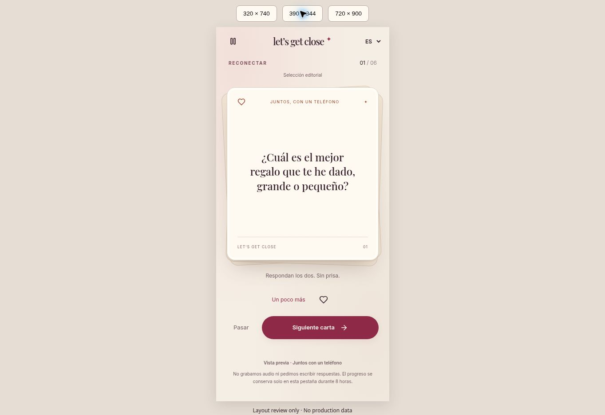
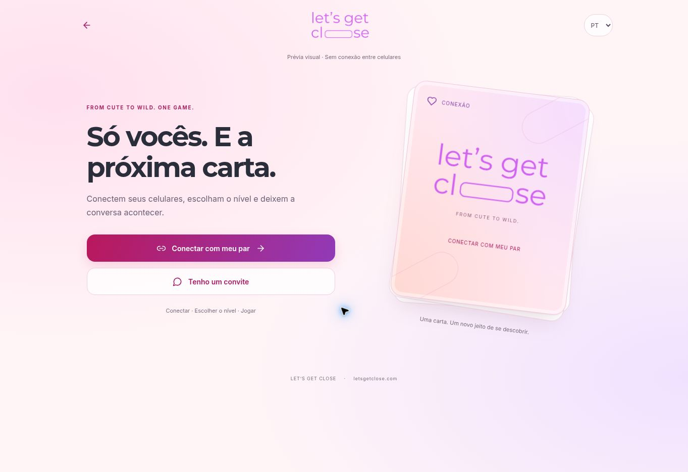
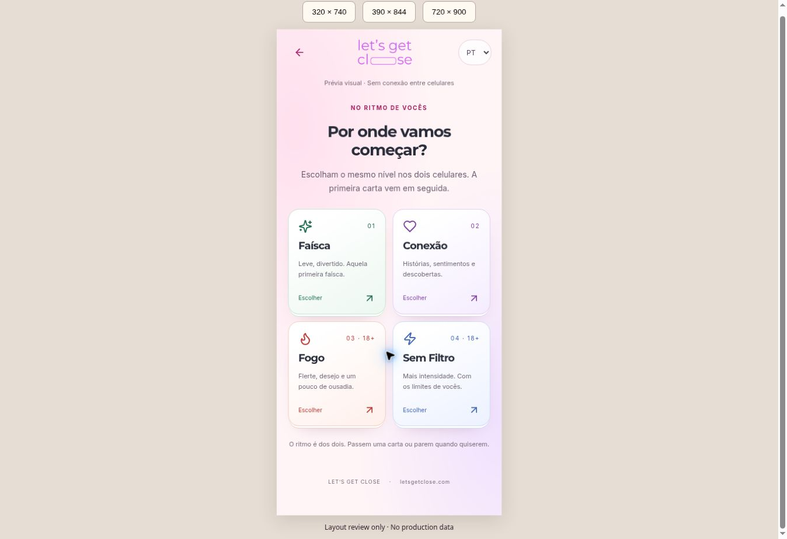
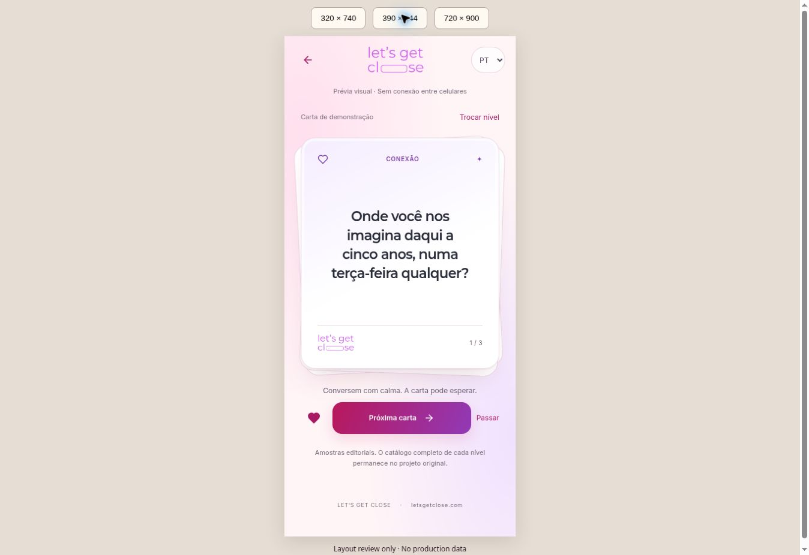

# Let’s Get Close — launch candidate

This branch builds on `claude/project-complete-analysis-30nhin` at `2d3b74f`, preserving its realtime rooms, account upgrade, Premium, four languages and existing question library. That branch was 23 commits ahead of `main` when reviewed. Do not replace it with an older checkout.

## Product change

The optional `/together` route provides a complete, free, single-phone evening with no account, checkout, answer recording or per-answer ratings. Couples choose a mood, approximate duration (6/10/16 cards), independent sensuality and emotional-depth limits, then each confirms the pace and adulthood. Changing preferences clears both confirmations. Cards turn over on tap; partners speak, guess each other's answers, pass, pause, soften the remaining deck or end early. Optional favorite **card IDs** are retained only with this tab's session, not partner answers. A refreshed page resumes for up to eight hours. The closing card invites an actual next date.

Sixty existing editorial questions, in English, Spanish, Portuguese and French, now share one catalog between the Daily Spark, landing previews, local play and AI planner. No database question content was replaced. The paper card component is also used by existing realtime rooms. Reduced motion disables the flip transition.

Optional AI prepares an order of existing question IDs within explicit limits. It does not listen, interpret unrecorded speech, generate intimate profiles, or adjust consent. A failed/slow request falls back to the editorial deck within eight seconds; a late response cannot replace an active game. Server limits: five attempts per identity per day and 500 total per day. This limits spend but is not full abuse prevention against disposable guest identities; configure Supabase anonymous sign-in protections before exposing the online service.

## Privacy and payment changes

- Both online players now require real Supabase identities (permanent or anonymous-auth JWT). Forged `localStorage` player UUIDs are removed.
- A new migration removes no-JWT reads/writes on room data, binds join and game RPCs to `auth.uid()`, serializes seat assignment, and revokes historical SECURITY DEFINER maintenance RPCs from clients. The client allowlist uses **exact signatures**, so older overloads cannot inherit access accidentally.
- Edge room guards reject missing identities before querying data. Recent rooms are no longer a public access window.
- `grant_checkout_credits` atomically commits the Stripe ledger and credits. Webhook and success-page verification use the same transaction. Subscription checkout no longer claims a ledger record before persisting state.
- Removed an unsupported comparative percentile from new analysis generation and from rendering old reports. Existing compatibility/bond metrics still describe user ratings; they are not validated clinical or relationship diagnostics. A deeper report redesign remains separate.
- Pageview URLs omit invite query strings. CORS supports the original `.com` domain and retains `.app` compatibility. Canonical URLs, sitemap and robots now use the owner-confirmed `.com`; support mailbox ownership is still unverified.

## Validation

`npm run typecheck`, `npm test`, `npm run build` and lint of the new surfaces are the release checks. Node 24 is required by the test runner. Tests execute the actual new SQL migrations in embedded PostgreSQL with a minimal schema fixture; they cover cross-room isolation, forged identities, legacy RPC privileges, seat limits, duplicate grants, transactional rollback/retry and AI usage caps. They also exercise all 54 deck configurations repeatedly, model-output validation, four-language completeness, and session recovery/expiry.

These are not a substitute for applying all historical migrations and testing two real clients against Supabase Realtime. Full-repository ESLint had 171 errors and 38 warnings **before** this change. CI gates type checking, focused lint, SQL/domain tests and production build without claiming that legacy lint debt is fixed.

## Deployment status and order

The configured Supabase ref is `bbdeyohqrutithaziulp`. It was absent from both connected Supabase accounts. The original Lovable project `9efb8ab7-d861-473b-88f1-2736da9c245d` returned `project_not_found` from the connected account. No production database, Edge Function, Stripe configuration, DNS, original published site or `main` branch was changed during development.

1. Restore access to the existing Supabase and hosting projects. Inspect deployed migrations and function versions first; this repository contains historical migrations and the August launch migrations were not previously verified as applied.
2. In staging, enable anonymous sign-in and verify the profile trigger from the August migration. Apply pending migrations in order, including `20261026110000_private_guest_rooms.sql` and `20261026120000_atomic_credits_and_date_plans.sql`. Do not bulk-run an unreviewed historical migration backlog against production.
3. Redeploy `intelligent-question-selector`, `getclose-ai-analysis`, `send-ai-analysis-email` (shared membership guard), `stripe-webhook`, `verify-payment`, and the new `plan-date` function. Supply the existing OpenAI/Stripe secrets and an explicit `ALLOWED_ORIGINS` list. No new secret is embedded in browser code.
4. Deploy the frontend together with the membership changes. Legacy no-JWT guests must rejoin using a new verified guest identity; schedule the cutover outside active games. Preserve prior branches for rollback, but do **not** roll back the privacy fix to public room access.
5. Verify two actual clients: create/pay or Premium entitlement, invite join, reconnect, level choice, one complete game and analysis access. Check a third identity cannot read either room. Replay a test-mode Stripe checkout through webhook and verification; ensure a single credit grant. Verify AI outage fallback and allowed-origin requests.
6. Only then promote the candidate to production and verify the canonical domain.

`VITE_TABLE_PREVIEW=true` now builds an isolated, explicitly labeled visual review of the connect → levels → cards flow at every route. It does not create rooms, simulate actual partners, process payments or request AI. It is explicitly labeled as a preview and must be unset for the full release. `vercel.json` supplies SPA deep-link rewrites; no domain is reassigned by that file.

## Previous one-phone browser review (superseded visual direction)

Playable isolated preview: https://lets-get-close-preview.vercel.app/

The deployed code at `8cacf5f` passed GitHub Actions Quality. Browser checks completed a six-card session, favorite save, follow-up reveal, refresh recovery, skip, pause, soften and closing screen. Both confirmations were cleared when limits changed. The preview-only `/review.html` page supplied actual 320×740 and 390×844 iframe viewports; the 320px setup and game had no horizontal overflow. This validates responsive layout in a desktop browser, not physical iOS/Android behavior.

The preview excludes online-room, payment and AI calls by design. Production and Stripe end-to-end checks remain pending for the reasons above. Full-repository lint after the changes reports 171 pre-existing errors and 37 warnings; the new-surface lint gate and TypeScript checks pass.

## Brand and journey correction — 26 October 2026

Owner feedback and the supplied GetClose Project Guide establish the original identity and two-phone journey as authoritative. The prior beige/serif one-phone-first preview was a product-direction mistake.

### Implemented

- `/play` is the connection entry: create a room or join by invitation; one-phone play is secondary at `/together`.
- Original uploaded pill-letter logo, Montserrat/Inter, blush pink, coral and purple. Cards have layered edges, tactile flip, readable type, level symbols and real brand artwork on both sides.
- Four choices follow the guide: Spark/Connection/Fire/No Filter with green/purple/red/blue accents. `LevelTiles` is shared with the actual online level-select screen; existing mutual level voting remains authoritative.
- The online room still reads its existing catalog and titles from Supabase. No production questions have been replaced. Removed fabricated fallback card counts.
- The isolated review uses existing Daily Spark editorial samples, labeled as samples rather than the full level catalog. No fictitious room codes or connected-player claims.
- Four-language entry, level descriptions and preview controls; restored the original translated level labels in local UI.
- `.com` replaces `.app` in canonical/social URLs, sitemap and robots. Existing support email addresses are not changed without verifying mailbox ownership.

### Remaining product and launch gaps

1. `CreateRoom.tsx` requires credits or Premium before a room can be activated. This interrupts the desired immediate entry; do not claim free online play. An introductory online session needs an explicit server-side entitlement design and abuse limits, not removal of a client check.
2. `LevelSelect.tsx` retains mutual voting, mismatch reset and countdown behavior. Redesigning it to a proposal/accept interaction would require server state changes and two-client regression tests. The visual change does not claim to solve those races.
3. The guide reports Spanish content in Portuguese/French database levels. Confirm and repair against the actual catalog once backend access is restored; local four-language samples do not prove the production catalog is correct.
4. The guide describes written answers, while code paths also refer to spoken responses. Audit the active production configuration before making an AI promise. AI cannot infer intimacy from speech it never receives, and ratings must not become purportedly scientific relationship scores.
5. The ideal experience starts with connection, uses one mutually selected level, shows one synchronized question, and keeps pass/pause available. AI should reduce selection work and offer optional conversation continuations within agreed limits. This is a product direction; those adaptive online capabilities are not live in the preview.
6. Original Supabase access, live two-device synchronization, payment integration and AI execution remain release gates. The visual review is not a replacement for letsgetclose.com.

### Corrected preview verification

Deployed code `515cdcb` is available at https://lets-get-close-preview.vercel.app/ . TypeScript, focused ESLint, all nine existing SQL/deck tests, production build and isolated preview build passed. Browser review exercised connection preview → four levels → card reveal → favorite → next → pass → finish → return to levels. At the 320px iframe viewport, the document client width and scroll width were both 305px (15px scrollbar), including the question screen; no horizontal overflow. The 390px view was visually inspected as well. These are responsive browser checks, not two real connected devices.

## Immersive cards and intelligence design

The latest isolated review removes the site header, demo label, explanatory paragraph and favorite button while a card is active. The phone becomes the card, with a small level/progress label, options, pass and an answered action. Optional microfeedback follows the answered action; no rating is preselected. This prototype stores one tester's impressions, pace choice, optional note and visible/focused card duration in memory only. It does not yet adapt the sequence, connect a partner or call AI. Those limits appear before entering and in the options/feedback sheets.

See [intelligent-card-experience.md](intelligent-card-experience.md) for the complete signal model, per-person/shared memory, adaptive narrative, deterministic boundaries, transactional selection, privacy and evidence-based report specification. Original online ratings remain unchanged pending integration. The legacy AI selector's prompt incorrectly labeled seconds as milliseconds; its label is corrected in code, not yet deployed as an Edge Function.
